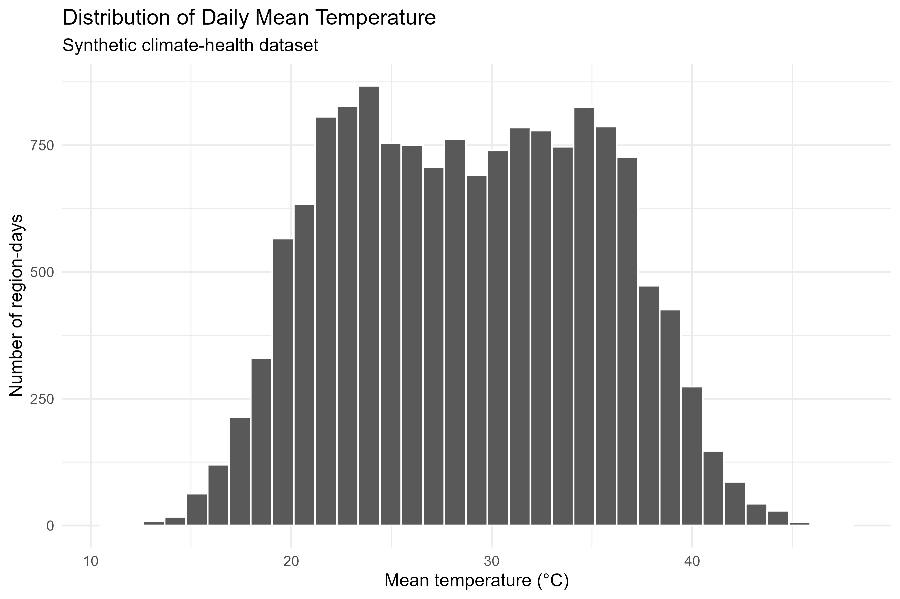
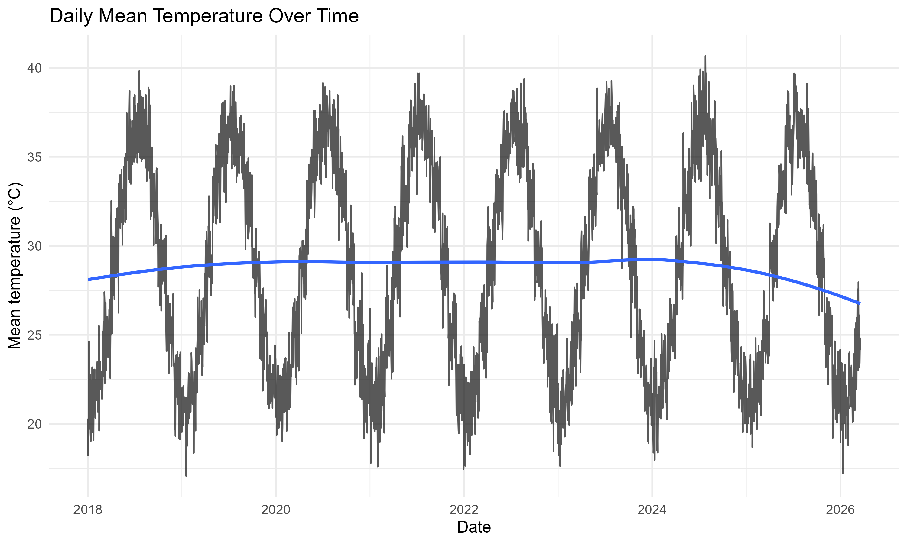
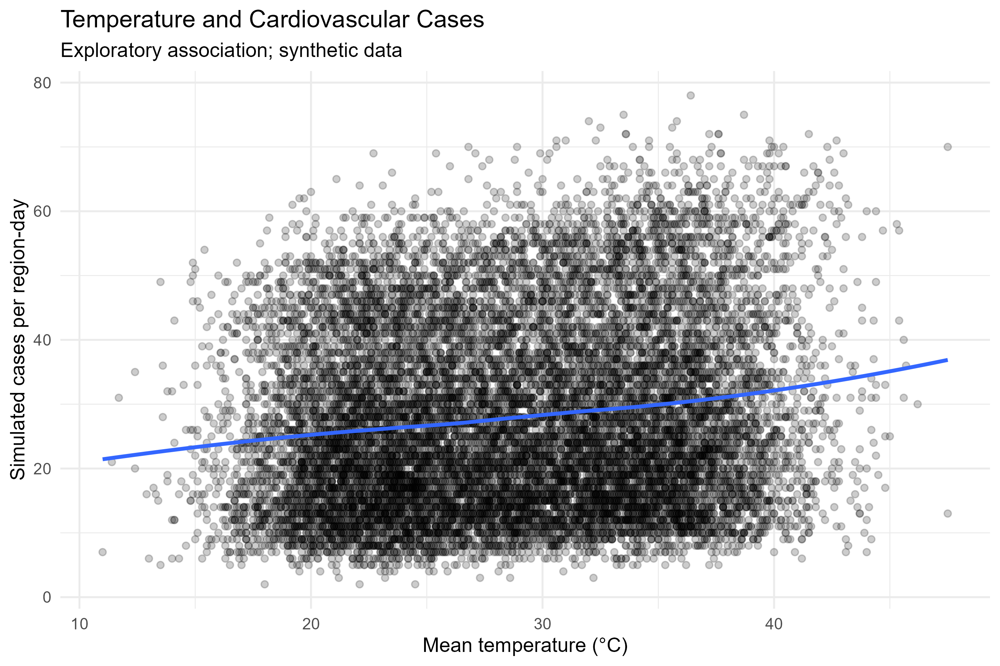
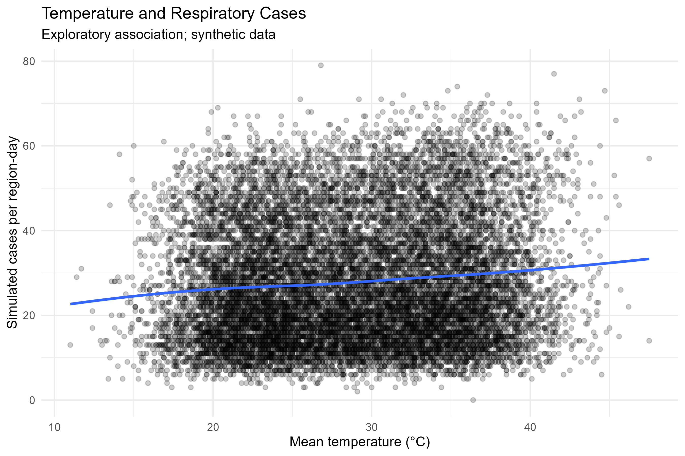

# Climate and Health Epidemiology: An R-Based Analytical Project

**Author:** Oumar Mahamat Ahmat, MPH Epidemiology  
**Focus:** Epidemiology | Climate and Health | Statistical Analysis | Reproducible Research  
**Tools:** R, RStudio, ggplot2, Poisson Regression, Negative Binomial Regression

## Project Overview

This project demonstrates an epidemiological workflow for examining the relationship between daily temperature and simulated cardiovascular and respiratory health outcomes across five fictional regions.

The analysis includes data quality assessment, exploratory data analysis, visualization, count regression models, model comparison, preliminary diagnostics, and automated report generation.

> **Important data disclaimer:** The dataset is entirely synthetic and was generated for educational and portfolio development purposes. It does not represent actual patients, observed disease surveillance data, or real-world climate-related health effects.

## Research Questions

1. How does simulated daily temperature vary over time and across regions?
2. How are temperature and simulated cardiovascular case counts associated in the generated dataset?
3. How are temperature and simulated respiratory case counts associated in the generated dataset?
4. How do Poisson and negative binomial regression models compare using AIC?

## Analytical Workflow

- Data quality checks and missing-value assessment
- Descriptive statistics and exploratory data analysis
- Visualization of temperature patterns and health outcomes
- Poisson regression with a population offset
- Negative binomial regression for model comparison
- Preliminary model diagnostics
- Automated tables, figures, and Markdown reporting

## Preliminary Results

The Poisson models produced the following estimated temperature rate ratios:

| Outcome | Rate Ratio | 95% Confidence Interval |
|---|---:|---:|
| Cardiovascular cases | 1.0122 | 1.0112–1.0132 |
| Respiratory cases | 1.0081 | 1.0071–1.0091 |

The Poisson models had slightly lower AIC values than the corresponding negative binomial models for both outcomes. These differences were small and should not be interpreted as conclusive proof of superior model fit.

Because the data are synthetic and generated with predefined relationships, these estimates are demonstrations of statistical methods, not evidence of real-world associations or causation.

## Selected Visualizations

### Temperature Distribution

### Temperature Trends Over Time

### Temperature and Cardiovascular Cases

### Temperature and Respiratory Cases

*All figures are based on synthetic data and illustrate analytical methods only.*

## Project Outputs

- `reports/final_report.md` — generated analytical report
- `outputs/figures/` — exploratory and model-related visualizations
- `outputs/tables/` — descriptive summaries, model estimates, and diagnostics

## Reproducibility

The project was developed using R and RStudio. To reproduce the analysis:

1. Clone or download the repository.
2. Open the RStudio project file.
3. Install the packages required by the scripts.
4. Run the scripts in their documented order.
5. Review the generated figures, tables, and report.

Exact script names and execution order should be confirmed against the final repository structure.

## Limitations

- All data are synthetic.
- The outcome-generating process contains predefined relationships.
- Statistical significance in simulated data does not establish real-world scientific evidence.
- The current analysis does not establish causality.
- The project does not yet provide validated estimates of temperature-related health risks in Chad or any other population.

## Future Development

- Assess residual patterns and model assumptions.
- Investigate nonlinear temperature associations and potential lagged effects.
- Conduct sensitivity analyses.
- Incorporate documented, ethically usable real-world climate and health data.
- Develop a reproducible workflow for public health surveillance and climate-health research.

## Intended Use

This project is intended for learning, demonstration of analytical skills, and portfolio development. It is not intended for clinical decisions, public health policy decisions, or estimation of real disease burden.

**Contact:**  
LinkedIn: https://linkedin.com/in/oumar-mahamat-ahmat-3318332b  
GitHub: https://github.com/oumarfarouknew-maker  
EpData Solutions: https://oumarfarouknew-maker.github.io/epidata.solutions/
